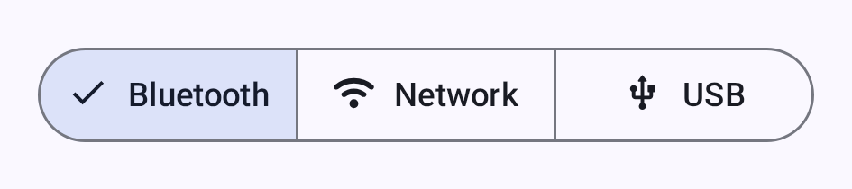

# Połączenia

MT_SW_APP obsługuje kilka metod komunikacji między telefonem lub komputerem a radiem.

## Bluetooth (BLE)

Bluetooth Low Energy to domyślna i najczęstsza metoda połączenia na Androidzie.

### Parowanie radia

1. Włącz radio. Większość radiów ogłasza się przez Bluetooth zaraz po uruchomieniu — nie trzeba wchodzić w żaden tryb parowania. Radia z kolorowym ekranem dotykowym są dostarczane z wyłączonym Bluetooth, więc najpierw włącz go z menu na ekranie samego radia.
2. Otwórz aplikację i przejdź do zakładki **Połącz**.
3. Dotknij **Skanuj w poszukiwaniu urządzeń Bluetooth** — pobliskie radia MT_SW pojawią się na liście.
4. Wybierz swoje radio z listy.
5. Android poprosi o sparowanie. Jeśli Twoje radio ma ekran, pokaże on sześciocyfrowy PIN — wpisz go w oknie Androida. Jeśli radio nie ma ekranu, PIN to `123456`.

Metodę parowania możesz zmienić, lub włączyć Bluetooth w radiu dostarczanym z wyłączonym, w **Ustawienia → Konfiguracja urządzenia → Bluetooth** — zobacz [Ustawienia — Radio i użytkownik](settings-radio-user). Więcej informacji znajdziesz w [konfiguracji Bluetooth](https://meshtastic.org/docs/configuration/radio/bluetooth) na meshtastic.org.

Użyj selektora transportu — rzędu przycisków segmentowych pod kartą połączenia — aby przełączać się między transportami Bluetooth, Sieć i USB (aktywny jest jeden naraz):

Na sprzęcie bez Bluetooth LE w selektorze nie ma **Bluetooth**, a na sprzęcie bez hosta USB nie ma **USB**. Gdy zostaje tylko **Sieć**, selektor jest ukryty.

> 💡 **Wskazówka:** Jeśli Twoje radio się nie pojawia, sprawdź, czy nie jest już połączone z innym telefonem lub czy nie jest poza zasięgiem.

Ekran nazywa wszystko, co po stronie aplikacji blokuje skanowanie, i podaje sposób naprawy:

| Co widzisz | Co to znaczy |
|---|---|
| Karta z prośbą o **Pobliskie urządzenia** | Uprawnienie nie zostało przyznane. **Przyznaj uprawnienie** je zgłasza; gdy Android przestanie pytać, przycisk zmienia się na **Otwórz ustawienia**. |
| **Bluetooth jest wyłączony** | Adapter jest wyłączony — karta otwiera ustawienia Bluetooth. |
| **Skanowanie Bluetooth wymaga też usług lokalizacji** | Tylko Android 11 i starsze: uprawnienie jest nadane, ale systemowy przełącznik lokalizacji jest wyłączony. |
| Brak karty oraz **Nie widziano urządzeń Bluetooth** pod nagłówkiem | Nic po tej stronie nie blokuje skanowania. Radio jest poza zasięgiem, wyłączone lub już połączone gdzie indziej. |

Wyjaśnienie znajduje się na tej karcie, a nie w kontrolce skanowania: dotknięcie **Skanuj w poszukiwaniu urządzeń Bluetooth** po jednokrotnym odmówieniu ponownie pyta Androida bezpośrednio.

### Stan połączenia

Ikona zakładki **Połącz** na pasku nawigacji pokazuje stan połączenia kolorem:

| Ikona | Stan | Opis |
|------|-------|-------------|
| 🟢 | Połączony | Aktywne łącze z radiem. Znaczek pokazuje używany transport: Bluetooth, Wi-Fi lub USB |
| 🟠 | Łączenie | Trwa uzgadnianie połączenia |
| 🔴 | Rozłączono | Brak aktywnego połączenia. Aplikacja ponawia próby automatycznie, z rosnącym odstępem między próbami |
| 🟡 | Urządzenie śpi | Radio jest w lekkim uśpieniu — aplikacja czeka, aż się obudzi i połączy ponownie, a nie zawodzi |

To cztery stany, które modeluje aplikacja. „Urządzenie śpi” jest normalne w konfiguracjach oszczędzających energię i nie wymaga żadnego działania.

Podczas łączenia wskaźnik stanu pokazuje bieżący stan połączenia — dotknij **Zatrzymaj łączenie**, aby przerwać próbę:

Gdy radio jest połączone, karta połączenia pokazuje jego nazwę i wersję oprogramowania, siłę sygnału przez Bluetooth oraz ustawienie modemu LoRa i region, na przykład „Long Range - Fast · United States”. Radio z własnymi ustawieniami modemu pokazuje **Własne** zamiast ustawienia. Dotknij wiersza z ustawieniem, aby otworzyć ekran LoRa.

Gdy nie wybrano jeszcze radia, karta połączenia pokazuje **Nie wybrano urządzenia**. Panel, w którym nie ma czego wyświetlić, mówi o tym pod swoim nagłówkiem, z podpowiedzią:

| Panel | Co pokazuje |
|---|---|
| Bluetooth | **Nie widziano urządzeń Bluetooth** oraz „Upewnij się, że jesteś w zasięgu urządzenia.” Rozpocznij skanowanie z nagłówka. |
| Sieć | **Nie widziano urządzeń sieciowych** oraz „Upewnij się, że jesteś połączony z tą samą siecią co urządzenie.” Pokazywane tylko wtedy, gdy nic nie zostało wykryte, a **Ostatnie urządzenia sieciowe** są puste. **Dodaj urządzenie ręcznie…** pozostaje pod spodem. |
| USB | **Nie wykryto urządzeń USB** oraz „Podłącz urządzenie kablem danych USB, aby użyć portu szeregowego.” |

### Rozwiązywanie problemów z Bluetooth

- **Nie znaleziono radia:** Wyłącz Bluetooth i włącz go ponownie. W Androidzie 11 i starszych sprawdź też, czy systemowe usługi lokalizacji są włączone — te wersje nie zwracają wyników skanowania bez nich.
- **Nie udało się uruchomić skanowania Bluetooth:** Spróbuj ponownie, a jeśli problem się powtarza, wyłącz i włącz Bluetooth.
- **Połączenie się rozłącza:** Zbliż się do radia; sprawdź, czy nie ma zakłóceń.
- **Parowanie nie powiodło się lub nie zostało ukończone:** Sprawdź, czy uprawnienie **Pobliskie urządzenia** jest przyznane, a następnie sparuj ponownie.
- **Parowanie odrzucone:** Zapomnij urządzenie w ustawieniach Bluetooth Androida i spróbuj ponownie.
- **Nie udało się nawiązać stabilnego połączenia po wielokrotnych próbach:** Aplikacja przestała ponawiać po trzech nieudanych uzgodnieniach — radio, które tu ciągle zawodzi, zwykle zawiesza się przy ponownym połączeniu. Wyłącz i włącz zasilanie radia, a następnie dotknij go ponownie w zakładce **Połącz**, aby rozpocząć nową próbę.

## USB szeregowe

Połączenia USB to przewodowa alternatywa, przydatna na komputerze lub gdy Bluetooth jest niedostępny.

### Konfiguracja

1. Podłącz radio do telefonu kablem USB do transmisji danych. Kable tylko do ładowania nie mają linii danych, a radio na takim kablu nigdy nie pojawi się na liście.
2. Aplikacja poprosi o uprawnienie USB — dotknij **Zezwól**.
3. Połączenie zostanie nawiązane automatycznie.

> ℹ️ **Uwaga:** Połączenia USB wymagają obsługi OTG w urządzeniach z Androidem.

### Rozwiązywanie problemów z USB

- **Odmowa uprawnienia USB:** Odłącz radio i podłącz je ponownie — Android zapyta ponownie przy ponownym połączeniu.
- **Brak radia na liście:** Sprawdź, czy kabel przesyła dane, a nie tylko zasilanie, i czy telefon obsługuje OTG.

## TCP/IP (sieć)

Niektóre radia MT_SW obsługują łączność Wi-Fi/Ethernet, co pozwala na połączenia TCP w sieci lokalnej. Najpierw podłącz radio do swojej sieci. Połącz się z nim przez Bluetooth lub USB, otwórz **Ustawienia → Konfiguracja urządzenia → Sieć** i w **Opcje Wi-Fi** (Wi-Fi Options) włącz **WiFi włączone** oraz wpisz **SSID** i **Hasło**. Ekran Sieć pojawia się tylko dla radiów, których sprzęt obsługuje Wi-Fi lub Ethernet. Gdy radio dostanie adres, wróć i połącz się z nim przez sieć.

### Łączenie przez sieć

1. Upewnij się, że radio jest w tej samej sieci lokalnej co telefon/komputer.
2. W zakładce **Połącz** wybierz **Sieć** w selektorze transportu.
3. Wybierz radio na jeden z dwóch sposobów:
   - **Skanuj w poszukiwaniu urządzeń sieciowych** — włącz to, aby automatycznie wykrywać radia, które ogłaszają się w sieci lokalnej (mDNS / `_meshtastic._tcp`). Wykryte urządzenia pojawiają się na liście; dotknij jednego, aby się połączyć.
   - **Dodaj urządzenie ręcznie…** — wpisz adres IP radia (lub nazwę hosta) i port (domyślnie: `4403`).
4. Wcześniej używane adresy sieciowe są zapamiętywane w **Ostatnie urządzenia sieciowe** dla szybkiego ponownego połączenia (dotknij i przytrzymaj, aby usunąć).

Wykrywanie w sieci używa mDNS, które działa tylko wtedy, gdy telefon i radio są w tej samej podsieci. Jeśli telefon w ogóle nie jest w sieci Wi-Fi, aplikacja ostrzega, że skanowanie sieci może nic nie znaleźć. W Androidzie 17 i nowszych aplikacja potrzebuje uprawnienia do sieci lokalnej (**Uprawnienie do sieci lokalnej**), aby w ogóle dotrzeć do radia w Twojej własnej sieci Wi-Fi — nie tylko je wykryć — więc ręczne wpisanie adresu nie omija odmówionego uprawnienia. Przyznaj je z karty w panelu Sieć lub z sekcji **Uprawnienia** w **Ustawienia**. Radio pod adresem publicznym lub osiągane przez VPN nie wymaga uprawnienia.

### Kiedy używać TCP

- Radio jest w tej samej sieci lokalnej
- Testy z symulowanym radiem
- Środowiska, w których Bluetooth ma problemy z zakłóceniami

### Konfiguracja Wi-Fi dla mPWRD-OS

**Ustawienia → Konfiguracja Wi-Fi dla mPWRD-OS** (Wi-Fi Provisioning for mPWRD-OS) to osobne, węższe narzędzie. Wysyła dane logowania do Wi-Fi przez Bluetooth wyłącznie do urządzeń **mPWRD-OS**, używając ich własnego protokołu — nie konfiguruje Wi-Fi w zwykłym radiu MT_SW. Jest dostępne zarówno na Androidzie, jak i na desktopie.

1. Otwórz ekran i poczekaj, aż aplikacja znajdzie urządzenie przez Bluetooth.
2. Dotknij **Skanuj sieci**, a następnie wybierz sieć z **Dostępne sieci** — albo włącz **Sieć ukryta** i wpisz nazwę w **Nazwa sieci (SSID)**.
3. Wpisz **Hasło** i dotknij **Zastosuj**.

Jeśli skanowanie zgłosi **Nie znaleziono sieci** lub całkowicie się nie powiedzie, zbliż telefon do urządzenia i zeskanuj ponownie. Jeśli wróci **Nie udało się zastosować konfiguracji WiFi**, sprawdź hasło i spróbuj ponownie.

## Po pierwszym połączeniu

Bycie połączonym nie oznacza możliwości nadawania.

Radio opuszcza fabrykę bez ustawionego regionu LoRa i nie nadaje, dopóki go nie ustawisz. Gdy połączysz takie radio, zakładka **Połącz** pokazuje kartę **Wybierz swój region**; dotknij jej, aby otworzyć ekran LoRa i wybrać region, w którym się znajdujesz.

Po ustawieniu regionu zakładka ostrzega, jeśli radio jest tylko do odbioru: karta **Nadawanie jest wyłączone** z treścią „To urządzenie może odbierać, ale nie będzie niczego wysyłać przez LoRa.” Dotknij jej, aby otworzyć ten sam ekran i ponownie włączyć **Nadawanie włączone** (Transmit Enabled). Naraz pojawia się tylko jedna z tych dwóch kart — nieustawiony region sam w sobie zatrzymuje nadawanie radia, więc aplikacja wskazuje najpierw to i wstrzymuje kartę nadawania, dopóki nie ustawisz regionu.

Więcej informacji znajdziesz w [Ustawienia — Radio i użytkownik](settings-radio-user#lora-config).

## Live Update

Na Androidzie 16 i nowszym zakładka **Połącz** ma wiersz **Live Update**, gdy jesteś połączony. Umieszcza w pasku stanu i w powiadomieniu usługi jedną wybraną przez Ciebie rzecz:

- **Stan sieci:** połączenie, ile węzłów jest online, Twoje nieprzeczytane wiadomości i bateria Twojego węzła. Pasek stanu pokazuje węzły online, na przykład `5/12`.
- **Śledzenie węzła:** bateria jednego węzła, sygnał, kiedy był ostatnio słyszany, liczba skoków i odległość od Twojego węzła. Pasek stanu pokazuje jego baterię albo, gdy węzeł nie podaje baterii, jak dawno był słyszany. Węzeł wybierasz z listy (najpierw ulubione, potem ostatnio słyszane) albo wyszukujesz po nazwie.

Dotknij wiersza, aby uruchomić jedną z tych funkcji, przełączyć się na drugą albo ją zatrzymać. Działa tylko jedna naraz i jest wyłączona, dopóki jej nie uruchomisz. W szczegółach węzła przycisk **Śledź w Live Update** od razu zaczyna śledzić ten węzeł.

Zerwane połączenie nie zatrzymuje funkcji i pokazuje stan połączenia, dopóki węzeł nie wróci. Rozłączenie, zmiana węzła albo usunięcie lub zignorowanie śledzonego węzła ją zatrzymuje. Jeśli wiersz informuje, że Live Update jest wyłączone dla MT_SW_APP, Android pokazuje je jako zwykłe powiadomienie, dopóki nie zezwolisz na nie w ustawieniach systemu.

## Ponowne łączenie

Aplikacja łączy się ponownie z ostatnio wybranym radiem przy uruchomieniu. Transporty możesz przełączać w zakładce **Połącz** w dowolnym momencie.

Aby się rozłączyć, dotknij przycisku rozłączania w zakładce **Połącz**:

## Kafelek w szybkich ustawieniach

Na Androidzie możesz dodać kafelek **MT_SW_APP** do szybkich ustawień: rozwiń panel powiadomień, dotknij przycisku edycji (ołówek) i przeciągnij kafelek na miejsce.

- **Połączono** — kafelek jest włączony i pokazuje krótką nazwę Twojego węzła. Dotknięcie rozłącza, tak samo jak przycisk rozłączania w zakładce **Połącz**.
- **Łączenie** — kafelek jest włączony i pokazuje „Łączenie”. Dotknięcie anuluje.
- **Rozłączono** lub **Urządzenie śpi** — kafelek jest wyłączony. Dotknięcie łączy ponownie z ostatnio wybranym węzłem.
- **Nie wybrano urządzenia** — dotknięcie kafelka otwiera zakładkę **Połącz**, gdzie wybierasz węzeł.

Rozłączenie zapomina wybrany węzeł, więc po rozłączeniu kafelek otwiera zakładkę **Połącz**. Jeśli Android nie pozwala aplikacji połączyć się w tle, kafelek otwiera aplikację i połączenie zaczyna się stamtąd. Na zablokowanym telefonie kafelek najpierw prosi o odblokowanie.

## Połączenia na komputerze

Na komputerze (Linux/macOS/Windows) aplikacja obsługuje:
- **Bluetooth (BLE)** — przez bibliotekę Kable; działa na macOS, Linuksie i Windows
- **USB szeregowe** — główna metoda połączenia przewodowego
- **TCP/IP** — dla radiów podłączonych do sieci

Szczegóły dla poszczególnych platform i skróty klawiszowe znajdziesz w [Aplikacja na komputer](desktop).

## Powiązane tematy

- [Pierwsze kroki](onboarding) — konfiguracja przy pierwszym uruchomieniu i uprawnienia
- [Ustawienia — Radio i użytkownik](settings-radio-user) — konfiguracja Bluetooth, regionu i sieci
- [Wiadomości i kanały](messages-and-channels) — wyślij swoją pierwszą wiadomość, gdy radio jest połączone
- [Węzły](nodes) — zobacz, kto jeszcze jest w Twojej sieci mesh
- [Aplikacja na komputer](desktop) — szczegóły połączeń specyficzne dla komputera
- [Obsługiwane urządzenia](https://meshtastic.org/docs/hardware/devices) — pełna lista zgodnych radiów na meshtastic.org
