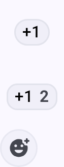

# Wiadomości i kanały

MT_SW obsługuje dwa tryby komunikacji: **rozgłoszenia na kanałach** i **wiadomości bezpośrednie**.

## Kanały

Kanały to wspólne grupy komunikacyjne. Wszystkie węzły skonfigurowane z tym samym kluczem kanału mogą czytać i wysyłać wiadomości na tym kanale.

### Kanał domyślny

Każdy węzeł z firmware Meshtastic ma domyślny kanał **LongFast**. Jest on szyfrowany powszechnie znanym kluczem domyślnym, więc każdy, kto używa tego samego presetu, może go czytać.

### Bezpieczeństwo kanału

Przy każdym kanale widnieje ikona kłódki, która pokazuje, jak dobrze kanał jest chroniony. Dotknij ikony, aby zobaczyć to samo wyjaśnienie w aplikacji.

| Ikona | Co oznacza |
|------|---------------|
| Zielona zamknięta kłódka | Kanał jest bezpiecznie zaszyfrowany kluczem AES 128-bitowym lub 256-bitowym. |
| Żółta otwarta kłódka | Kanał nie jest bezpiecznie zaszyfrowany — nie ma żadnego klucza albo ma powszechnie znany klucz jednobajtowy — i nie przenosi dokładnej lokalizacji. |
| Czerwona otwarta kłódka | Brak bezpiecznego szyfrowania, a kanał przenosi dokładne dane o lokalizacji. |
| Czerwona otwarta kłódka z ostrzegawczą plakietką | Brak bezpiecznego szyfrowania, kanał przenosi dokładne dane o lokalizacji i wysyła je do internetu przez MQTT. |

Sama długość klucza nie zmienia ikony: klucz 128-bitowy i 256-bitowy pokazują tę samą zieloną kłódkę.

> 🔒 **Bezpieczeństwo:** Do prywatnej komunikacji zawsze ustaw unikalny klucz PSK. Kanał domyślny jest celowo otwarty, aby nowi użytkownicy mogli znaleźć sieć mesh — ale do wszystkiego, co jest poufne, utwórz osobny, szyfrowany kanał.

### Dodawanie kanału

1. Połącz się ze swoim węzłem. Wiersz **Kanały** pozostaje wyszarzony, dopóki aplikacja nie ma połączenia — zobacz [Połączenia](connections).
2. Przejdź do **Ustawień**, a następnie dotknij **Kanały** w sekcji **Konfiguracja**.
3. Dotknij przycisku **+**, aby dodać kanał. Edytor otworzy się na nowej pozycji.
4. Ustaw nazwę kanału i **PSK** oraz wybierz, czy kanał ma używać wysyłania i pobierania przez MQTT. Nadanie nazwy nowemu kanałowi automatycznie generuje nowy 256-bitowy klucz; ikona odświeżania obok **PSK** generuje kolejny.
5. Dotknij **Zapisz**, aby zamknąć edytor. Zmiana jest na razie tylko w Twoim telefonie.
6. Dotknij **Wyślij** na dole listy kanałów, aby zapisać zmiany w węźle. **Anuluj** albo opuszczenie ekranu bez dotknięcia **Wyślij** odrzuca zmiany.
7. Opcjonalnie: udostępnij adres URL kanału lub kod QR osobom, które potrzebują dostępu.

Dotknięcie istniejącego kanału otwiera ten sam edytor, w którym możesz zmienić nazwę, PSK, wysyłanie i pobieranie przez MQTT oraz dokładność pozycji. Każda zmiana na tym ekranie — dodanie, edycja, usunięcie lub przeciągnięcie kanału w nowe miejsce — czeka na **Wyślij** w ten sam sposób.

### Zarchiwizowane kanały

Rozmowa należy do kanału, na którym była prowadzona, a nie do miejsca (slotu), które ten kanał zajmował. Gdy kanał znika z Twojego węzła — skanujesz kod QR innego kanału, zmieniasz klucz kanału lub przełączasz preset modemu — jego rozmowa zostaje **zarchiwizowana**, a nie usunięta ani wymieszana z tym, co zajmie ten slot.

Zarchiwizowana rozmowa:

- pozostaje na liście **Kanały** pod nazwą, jaką miał kanał, poniżej kanałów znajdujących się w Twoim węźle, oznaczona ikoną historii;
- zachowuje całą historię wiadomości, którą można przeszukiwać jak zwykle;
- jest tylko do odczytu — nie możesz wysyłać, odpowiadać ani reagować, ponieważ kanału nie ma już w węźle, więc nie ma na czym wysyłać, i nie jest on oferowany jako cel udostępniania;
- wraca automatycznie, jeśli ponownie dodasz dokładnie ten sam kanał, a jego wiadomości wracają do aktywnego slotu.

Zmiana presetu modemu również archiwizuje kanał: preset jest częścią tożsamości kanału domyślnego, więc **LongFast** i **MediumFast** to różne kanały, mimo że ani nazwa, ani klucz się nie zmieniły. Zmiana samego regionu niczego nie archiwizuje.

Aby usunąć zarchiwizowaną rozmowę na stałe, przesuń ją w lewo na liście rozmów albo dotknij jej i przytrzymaj, a potem usuń ją z paska działań.

## Wiadomości bezpośrednie

Wiadomości bezpośrednie (DM) trafiają do jednego, konkretnego węzła. Gdy oba węzły mają nawzajem swoje klucze publiczne, Twój węzeł szyfruje wiadomość kluczem publicznym drugiego węzła, więc nikt inny w sieci mesh nie może jej przeczytać — nawet węzły, które dzielą z Tobą kanał.

Twój węzeł musi już mieć klucz publiczny drugiego węzła, zanim będzie mogło wysłać wiadomość bezpośrednią. Klucze podróżują wewnątrz informacji o węźle, które węzły okresowo rozgłaszają, więc zwykle klucz pojawia się sam, gdy tylko usłyszysz dany węzeł. Dopóki to nie nastąpi, węzeł mający własną parę kluczy — czyli domyślnie — odmawia wysłania zamiast przechodzić na szyfrowanie kanału, a przy wiadomości widać **Klucz odbiorcy niedostępny**.

Rozmowa z kluczem publicznym ma na górnym pasku ikonę szyfrowania. Zielona zamknięta kłódka oznacza, że wiadomość bezpośrednia jest chroniona szyfrowaniem kluczem publicznym; czerwona ikona przekreślonego klucza oznacza, że klucz publiczny węzła zmienił się i nie zgadza się już z tym, który zapamiętał Twój węzeł. Dotknij ikony, aby zobaczyć szczegóły. Ta ikona opisuje szyfrowanie rozmowy, więc przy każdej wersji firmware zostają kłódki, a nie odznaki podpisu i weryfikacji z listy węzłów.

### Wysyłanie wiadomości bezpośredniej

1. Otwórz kartę **Wiadomości** i wybierz rozmowę albo dotknij i przytrzymaj węzeł na liście węzłów i wybierz **Wiadomość**.
2. Wpisz wiadomość i dotknij **Wyślij**.

Na klawiaturze sprzętowej Enter wysyła wiadomość, a Shift+Enter zaczyna nową linię. Klawisz Enter na klawiaturze ekranowej zawsze zaczyna nową linię.

### Zarządzanie listą rozmów

Karta **Wiadomości** pokazuje listę Twoich rozmów. Każdy wiersz pokazuje najważniejsze informacje i
można na nim działać bezpośrednio:

- **Niewysłane szkice są zachowywane.** Wpisz tekst w rozmowie i wyjdź bez wysyłania, a tekst nadal
  tam będzie po powrocie. Wiersz pokazuje go jako `Szkic: …` zamiast ostatniej wiadomości —
  niewysłany szkic to rzecz, na którą wiersz czeka właśnie od *Ciebie*.
- **Plakietka nieprzeczytanych.** Licznik widnieje na wierszu, dopóki nie otworzysz rozmowy.
- **Przesuń w prawo, aby wyciszyć** (przesuń ponownie, aby wyłączyć wyciszenie) i **przesuń w lewo, aby usunąć**. Usunięcie
  najpierw pyta o potwierdzenie; wyciszenie pokazuje komunikat z przyciskiem **Cofnij**.
- **Dotknij i przytrzymaj, aby zaznaczyć** jedną lub więcej rozmów, a następnie użyj paska działań, aby je **Przypiąć**,
  **Oznaczyć jako nieprzeczytane**, wyciszyć lub usunąć razem. Gdy każda zaznaczona rozmowa jest już
  przypięta, **Przypnij** zmienia się w **Odepnij**. Przypięte rozmowy mają znacznik pinezki i wędrują
  na górę **własnej sekcji**.
- **Ikona (i) u góry listy** otwiera krótki opis: co robi dotknięcie, przytrzymanie i przesunięcie, jak wyciszać oraz co znaczą etykiety dostarczenia.
- **Czasy wyciszenia są wszędzie takie same:** 1 godzina, 24 godziny, 2 dni, 1 tydzień, 2 tygodnie, 1 miesiąc albo na zawsze (rozmowy prywatne, kanały i urządzenie na kanale). Starsze wyciszenia na 8 godzin działają, aż wygasną. Wyciszone wiadomości nadal się zapisują; wyłączone są tylko powiadomienia i dźwięk.
- **Lista jest podzielona na Kanały i Wiadomości bezpośrednie**, każda z zwijanym nagłówkiem i każda
  sortowana niezależnie — dzięki temu przypięta wiadomość bezpośrednia wędruje na górę swojej sekcji, a nie ponad sekcję
  Kanałów.

### Dymki rozmów

W Androidzie 11 i nowszym powiadomienie o wiadomości można otworzyć jako pływający **dymek**, który
pozostaje na wierzchu, cokolwiek innego robisz. Dotknij ikony dymka w powiadomieniu, aby przekształcić
rozmowę; Android zapamiętuje ten wybór dla każdej rozmowy, a systemowe ustawienia Dymków
decydują, czy w ogóle są oferowane.

### Stany wiadomości

Etykieta statusu pojawia się wyłącznie pod **Twoimi własnymi** wiadomościami wychodzącymi (wiadomości przychodzące od innych nie mają etykiety statusu):

| Stan | Znaczenie |
|-------|---------|
| Wysyłanie... | W kolejce lub już przekazana Twojemu węzłowi, jeszcze nierozstrzygnięta w żadną stronę. Oba etapy mają ten sam tekst, ale ikona i kolor zmieniają się w trakcie — żółta chmurka z strzałką w górę, gdy czeka w kolejce, niebieska strzałka, gdy Twój węzeł już ją ma |
| Dostarczono do odbiorcy | Dla wiadomości bezpośredniej wróciło potwierdzenie odbioru |
| Dostarczono do odbiorcy · potwierdzone | Najsilniejsze potwierdzenie. Potwierdzenie zawierało dowód, który mógł wytworzyć tylko odbiorca. Wymaga firmware 2.8.1 lub nowszego |
| Dowód dostarczenia nieudany | Coś potwierdziło wiadomość bez klucza, który ma tylko odbiorca, więc to potwierdzenie nie dowodzi, że odbiorca ją dostał |
| Dostarczono do sieci mesh | Dla rozgłoszenia na kanale: wiadomość dotarła do sieci mesh (rozgłoszenia nie mają potwierdzenia od poszczególnych odbiorców) |
| Przekazane, niepotwierdzone przez odbiorcę | Dla wiadomości bezpośredniej, pokazywane w kolorze ostrzegawczym — wiadomość została przekazana dalej, ale nie wróciło jeszcze potwierdzenie |
| Trasowanie przez łańcuch SF++… | Wiadomość jest trasowana/buforowana przez łańcuch Store & Forward Plus Plus |
| Potwierdzone w łańcuchu SF++ | Potwierdzone jako dostarczone przez łańcuch SF++ |
| Błąd | Dostarczenie nie powiodło się — dotknij statusu, aby poznać konkretny powód (zobacz [Błędy dostarczania](#delivery-errors)) |

Dotknij statusu pod nieudaną wiadomością albo pod wiadomością bezpośrednią oznaczoną **Przekazane, niepotwierdzone przez odbiorcę** i wybierz **Wyślij ponownie**, aby wysłać ją jeszcze raz. Wiadomość zostaje na swoim miejscu w rozmowie, a jej status zaczyna się od nowa. **Wyślij ponownie** nie jest dostępne przy **Niezgodność kanału/klucza** ani **Wiadomość jest za duża, by ją wysłać**, bo druga próba tego nie naprawi, ani w zarchiwizowanej rozmowie.

### Błędy dostarczania

Gdy wiadomości nie uda się dostarczyć, wskaźnik błędu pokazuje, co poszło nie tak:

| Błąd | Znaczenie | Co zrobić |
|-------|---------|------------|
| Brak trasy | Nie istnieje ścieżka do węzła docelowego | Odbiorca może być offline lub poza zasięgiem sieci mesh. Spróbuj później albo podejdź bliżej. |
| Brak interfejsu radiowego | Brak dostępnego interfejsu radiowego do wysyłania | Sprawdź, czy Twój węzeł jest połączony i dostępny. |
| Nie udało się dostarczyć do sieci mesh | Wyczerpano ponowienia. Ta sama etykieta obejmuje trzy przyczyny — odmowę przekaźnika (NAK), zwykłe przekroczenie czasu i wyczerpanie retransmisji | Podejdź bliżej, popraw sygnał albo poczekaj na poprawę warunków. Dotknij błędu, aby poznać konkretną przyczynę. |
| Przekroczono limit wysyłania | Sieć mesh ogranicza Cię za zbyt szybkie wysyłanie | Poczekaj przed ponownym wysłaniem. |
| Brak autoryzacji | Cel odrzucił żądanie | Sprawdź, czy masz właściwy kanał i klucze dla tego węzła. |
| Odbiorca potrzebuje Twojego klucza | Szyfrowanie wiadomości bezpośredniej nie mogło zostać dokończone, bo drugi węzeł nie ma jeszcze Twojego klucza publicznego | Wymieńcie się informacjami o węźle — klucz podróżuje razem z nimi. Częste przy pierwszej wiadomości bezpośredniej do nowego kontaktu. |
| Klucz odbiorcy niedostępny | Nie masz klucza publicznego odbiorcy | Poczekaj na nadejście jego informacji o węźle albo poproś go o ich rozgłoszenie. |
| Nie udało się wysłać zaszyfrowanej wiadomości | Szyfrowanie tej wiadomości bezpośredniej nie powiodło się | Sprawdź, czy oba węzły wymieniły się kluczami i mają zgodne firmware. |
| Sesja administratora wygasła | Sesja zdalnego zarządzania przekroczyła limit czasu | Otwórz ponownie ustawienia zdalnego węzła, aby rozpocząć nową sesję. |
| Klucz administratora nieautoryzowany | Węzeł docelowy nie akceptuje Twojego klucza administratora | Sprawdź, czy klucz administratora zgadza się na obu węzłach. |
| Niezgodność kanału/klucza | Kanał/klucz docelowy nie pasuje | Sprawdź, czy oba węzły mają ten sam kanał i PSK. |
| Wiadomość jest za duża, aby ją wysłać | Wiadomość przekracza maksymalny rozmiar danych | Skróć wiadomość i spróbuj ponownie. |
| Brak odpowiedzi aplikacji | Aplikacja lub wtyczka nie odpowiedziała na żądanie | Spróbuj ponownie albo sprawdź stan docelowej aplikacji lub modułu. |
| Limit cyklu pracy | Osiągnięto regionalny limit czasu nadawania | Poczekaj, aż okno cyklu pracy się zresetuje. |
| Nieprawidłowe żądanie | Żądanie jest zniekształcone lub nieprawidłowe | Jeśli problem się powtarza, spróbuj ponownie po zaktualizowaniu lub ponownym uruchomieniu aplikacji. |

> 💡 **Wskazówka:** Większość błędów dostarczania ustępuje sama. Jeśli węzeł jest osiągalny z przerwami, sieć mesh ponowi próbę. W przypadku uporczywych błędów **Brak trasy** sprawdź, czy pośrednie węzły Router są online.

## Funkcje wiadomości

### Szablony wiadomości

Gotowe wiadomości do szybkiej komunikacji, przydatne, gdy pisanie jest niewygodne (rękawiczki, mały ekran, pilna sytuacja):

- Wiersz szablonów jest ukryty, dopóki go nie włączysz. Otwórz rozmowę, dotknij menu dodatkowego na górnym pasku, a następnie **Pokaż menu szybkiego wyboru**. **Ukryj menu szybkiego wyboru** chowa wiersz z powrotem.
- Wiersz zawiera jedną wbudowaną pozycję, dzwonek alarmowy 🔔. Dodaje on wiadomość alarmową zawierającą znak dzwonka, którą klienty obsługujące tę funkcję oznaczają jako alert. Każdy inny przycisk w wierszu to taki, który sam utworzyłeś.
- Dodawaj, edytuj, zmieniaj kolejność i usuwaj własne pozycje z tego samego menu dodatkowego — dotknij **Szablony wiadomości**.

Każdy szablon ma **Nazwę** — etykietę przycisku, ograniczoną do pięciu znaków, zamienianą na wielkie litery i uzupełnianą automatycznie na podstawie tekstu wiadomości — oraz **Wiadomość**, którą niesie. Przełącznik decyduje, co robi dotknięcie przycisku. Nowa pozycja zaczyna z ustawieniem **Wyślij natychmiast**, więc dotknięcie od razu wysyła wiadomość; wyłącz przełącznik, a etykieta zmieni się na **Dodaj do wiadomości**, co wstawia tekst do pola wpisywania, abyś mógł go najpierw zmienić.

### Wyszukiwanie wiadomości

Wyszukiwanie obejmuje pełną historię dowolnej rozmowy, z ekranu czatu:

1. Otwórz rozmowę (kanał lub wiadomość bezpośrednią).
2. Dotknij **ikony wyszukiwania** na górnym pasku.
3. Wpisz tekst w polu **Szukaj wiadomości…**. Wyszukiwanie działa w trakcie pisania, we wszystkich zapisanych wiadomościach tej rozmowy.
4. Użyj licznika wyników **N / M** i **strzałek poprzedni / następny**, aby przeskakiwać między trafieniami, które są podświetlone w rozmowie.

Wyszukiwanie zostaje w rozmowie, z której je otworzyłeś, i nie sięga do innych kanałów ani kontaktów. Porównuje wiadomości zapisane w Twoim telefonie, więc działa offline.

### Filtr wiadomości

Menu dodatkowe rozmowy prowadzi też do filtra wiadomości, który ukrywa wiadomości zawierające słowa z Twojej listy. **Filtr wiadomości** otwiera jego ustawienia, **Pokaż N odfiltrowanych** odkrywa to, co ukrył w tej rozmowie, a **Wyłącz filtr tutaj** wyłącza go tylko dla tej rozmowy. Listę słów znajdziesz w [Ustawienia — Moduły i administracja](settings-module-admin).

### Dymki wiadomości

Wiadomości wyświetlają się jako dymki czatu — wysłane po prawej, odebrane po lewej. Każdy dymek pokazuje nadawcę, czas i status dostarczenia. Wiadomości z odpowiedziami zawierają cytowany podgląd oryginalnej wiadomości nad odpowiedzią.

### Formatowanie tekstu

Wiadomości obsługują proste formatowanie **Markdown** w tekście. Odebrane wiadomości pokazują stylizację bez znaków składni:

| Rodzaj | Składnia | Wygląda jako |
|------|--------|------------|
| Pogrubienie | `**bold**` | **bold** |
| Kursywa | `*italic*` | *italic* |
| Przekreślenie | `~~strike~~` | ~~strike~~ |
| Kod w tekście | `` `code` `` | czcionka monospace `code` |
| Link | `[label](https://example.com)` | dotykalny **label** |

Podczas pisania ustaw kursor w polu wiadomości i wpisz co najmniej trzy znaki, aby pokazać **pasek formatowania** pod polem wpisywania. Zaznacz tekst i dotknij stylu, aby go otoczyć znacznikami (dotknij ponownie, aby usunąć); bez zaznaczenia styl wstawia pustą parę znaczników z kursorem pomiędzy nimi. Przycisk linku otwiera okno do wpisania adresu URL. Podczas pisania pole pokazuje tekst ze stylem, ale wysyłana wiadomość nadal zawiera znaki Markdown.

Formatowanie jest przenoszone jako zwykłe znaki w sieci mesh, te same bajty, które wysyła klient Apple. Klienty, które nie obsługują Markdown (starsze aplikacje, proste klienty firmware), pokazują surowe znaki `**`/`~~`. Adresy URL, adresy e-mail i numery telefonów są automatycznie zamieniane na linki, niezależnie od tego, czy używasz Markdown.

### Wzmianki

Wpisz `@` podczas pisania, aby wspomnieć o węźle — selektor podpowiada pasujące kontakty w trakcie pisania. W odebranej wiadomości wzmianka pojawia się jako podświetlony znacznik z nazwą węzła; dotknij go, aby przejść prosto na stronę szczegółów tego węzła.

### Reakcje

Reaguj na wiadomości za pomocą emoji:
- **Dotknij i przytrzymaj** wiadomość — albo dotknij jej dwukrotnie — aby wyświetlić nad dymkiem pasek szybkich reakcji. Otwarcie paska niczego nie wysyła.
- Dotknij emoji na pasku, aby je wysłać; dotknij **Więcej reakcji**, aby otworzyć pełny selektor, albo dotknij gdziekolwiek poza
  paskiem, aby go zamknąć bez wysyłania. Reakcja to prawdziwy pakiet w sieci mesh, więc jest wysyłana
  dopiero po wybraniu emoji.
- Reakcje pojawiają się pod dymkiem wiadomości
- Wielu użytkowników może reagować na tę samą wiadomość
- Możesz reagować na własne wiadomości lub cudze

Reakcje zużywają mniej przepustowości sieci mesh niż pełne wiadomości tekstowe.

### Odpowiadanie

**Przesuń wiadomość w prawo**, aby na nią odpowiedzieć — pole pisania otworzy się z zacytowaną tą wiadomością.
Przesunięcie poza próg odpowiedzi uzbraja akcję; puszczenie przed progiem cofa gest i nic nie jest wysyłane.
Odpowiedź jest też w arkuszu działań, do którego dochodzi się przez dotknięcie i przytrzymanie, a następnie dotknięcie **Więcej działań na wiadomości**.

### Separatory dni

Wiadomości są grupowane według dni. Separator nad pierwszą wiadomością każdego dnia pokazuje **Dziś**
lub **Wczoraj** dla dwóch ostatnich dni, a dla starszych samą datę.

### Przejdź do najnowszych

Przewijanie rozmowy wstecz wywołuje przycisk przejścia do najnowszych wiadomości. Gdy wiadomości przychodzą,
a Ty jesteś przewinięty w górę, przycisk podaje ostatniego nadawcę i dodaje licznik pozostałych nieprzeczytanych
wiadomości. Licznik dotyczy wiadomości, nie osób — pięć nieprzeczytanych od jednej osoby wyświetla się jako jej nazwa
**+4**.

### Działania na wiadomościach

Dotknij i przytrzymaj albo dotknij dwukrotnie wiadomość, aby otworzyć pasek szybkich reakcji, a następnie dotknij **Więcej działań na wiadomości**
(ikona menu dodatkowego na tym pasku), aby otworzyć arkusz działań. Rząd emoji biegnie wzdłuż góry
arkusza — tam są reakcje. Pod nim pojawia się **Podpisano · zweryfikowano** przy wiadomości, której
podpis Twój węzeł sprawdził kluczem nadawcy, oraz **Dostarczenie potwierdzone**, **Dowód dostarczenia nieudany**
albo **Dowód dostarczenia niesprawdzony**, gdy potwierdzenie Twojej wiadomości zawierało dowód dostarczenia.
Dalej idą czas wiadomości i status dostarczenia, a potem te działania:

- **Odpowiedz** — zacytuj wiadomość w swojej odpowiedzi
- **Kopiuj** — skopiuj tekst wiadomości do schowka
- **Przetłumacz** — przetłumacz odebraną wiadomość na język urządzenia i przełączaj się między oryginałem a tłumaczeniem (tylko wersja Google Play; używa tłumaczenia na urządzeniu). Pierwsze tłumaczenie na dany język prosi o pobranie jednorazowego modelu językowego i podaje jego rozmiar, a po zakończeniu pobierania tłumaczy. Jeśli pobieranie się nie powiedzie albo wiadomość jest już w Twoim języku, aplikacja informuje o tym zamiast tłumaczyć
- **Wybierz** — włącz zaznaczanie wielu, aby działać na kilku wiadomościach naraz
- **Wycisz wiadomości od tego urządzenia na tym kanale** — (tylko na kanałach, nie przy Twoich wiadomościach) wybierz czas wyciszenia z listy. Wiadomości nadal się zapisują i są widoczne; wyłączone są tylko powiadomienia i dźwięk, i tylko na tym jednym kanale. Obok nazwy wyciszonego urządzenia pojawia się mała ikona głośnika, a ta sama pozycja menu zmienia się w **Włącz powiadomienia od tego urządzenia na tym kanale**. Wyciszenie przetrwa restart aplikacji
- **Usuń** — usuń wiadomość z tego telefonu. Działa na każdej wiadomości w rozmowie, Twojej lub cudzej, i nie usuwa jej z niczyjego węzła ani telefonu

### Priorytet wiadomości

Aplikacja wysyła każdą tworzoną przez Ciebie wiadomość z tym samym, domyślnym priorytetem — nie ma
poziomu awaryjnego ani alarmowego do wyboru i nic w aplikacji nie podnosi wiadomości bezpośredniej ponad
rozgłoszenie na kanale. Ewentualne nadawanie pierwszeństwa między nimi odbywa się w firmware, nie tutaj. (Aplikacja
oznacza część własnego ruchu wewnętrznego, takiego jak pakiety administracyjne i traceroute, jako
niezawodne lub działające w tle, ale nie masz na to wpływu z poziomu pola tworzenia wiadomości.)

### Limity wiadomości

- **Maksymalna długość:** 200 bajtów (około 200 znaków dla tekstu ASCII)
- Limit 200 bajtów dotyczy pola tworzenia wiadomości w aplikacji — sam limit danych w sieci mesh wynosi 233 bajty, więc wiadomości od innych nadawców (np. Funkcje aplikacji) mogą docierać nieco dłuższe
- **Ograniczanie szybkości:** Sieć mesh egzekwuje sprawiedliwy podział czasu antenowego; duży ruch wiadomości może być ograniczany
- **Dostarczanie:** Wiadomości są automatycznie ponawiane, jeśli nie nadejdzie potwierdzenie

## Dobre praktyki

- Używaj kanałów do koordynacji grupy
- Używaj wiadomości bezpośrednich do prywatnej komunikacji między dwiema osobami
- Pisz krótko — przepustowość sieci mesh jest ograniczona
- Skonfiguruj szyfrowanie dla poufnej komunikacji

## Zobacz także

- [Węzły](nodes) — dotknij węzła, aby rozpocząć wiadomość bezpośrednią
- [Ustawienia — Radio i użytkownik](settings-radio-user) — konfiguracja szyfrowania kanałów i presetów
- [MQTT](mqtt) — most między wiadomościami kanału a internetem
- [Konfiguracja kanałów](https://meshtastic.org/docs/configuration/radio/channels) — szczegółowe ustawienia kanałów na meshtastic.org
