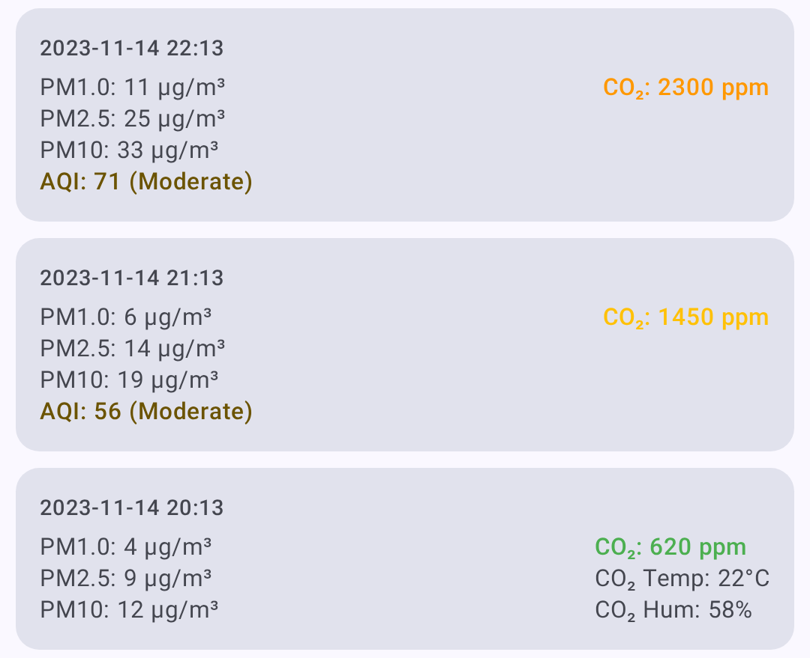

# Metryki węzła

Ekran szczegółów węzła udostępnia pełną telemetrię i metryki każdego węzła w Twojej sieci mesh.

## Podgląd metryk

1. Przejdź do **Węzły**.
2. Dotknij węzła, który chcesz sprawdzić.
3. Przewiń do sekcji **Telemetria** i znajdź interesującą Cię kategorię — **Jakość sygnału**, **Metryka urządzenia**, **Metryki środowiskowe**, **Metryki jakości powietrza**, **Metryki zasilania**, **Pozycja** i pozostałe.
4. Dotknij przycisku odświeżania w wierszu, aby poprosić węzeł o świeży odczyt. Przycisk wykresu obok niego otwiera historię tej kategorii i pojawia się, gdy węzeł zgłosi ten rodzaj telemetrii.

Wiersz **Pozycja** rozwija się, pokazując dane o lokalizacji węzłów, które udostępniają GPS:

> ℹ️ **Uwaga:** Metryki są dostępne tylko wtedy, gdy zostały zgłoszone przez zdalny węzeł. Metryki aktualizują się w odstępach skonfigurowanych w ustawieniach telemetrii każdego węzła.

## Metryka urządzenia

Podstawowe informacje o pracy zgłaszane przez każdy węzeł:

| Metryka | Opis |
|--------|-------------|
| Poziom baterii | Bieżący procent naładowania baterii |
| Napięcie | Odczyt napięcia baterii |
| ChUtil | Procent lokalnego czasu antenowego w użyciu |
| AirUtil | Procent ostatniej godziny, który ten węzeł spędził na nadawaniu |
| Czas pracy | Czas od ostatniego restartu |

Metryka urządzenia nie ma kart na ekranie szczegółów węzła. Użyj przycisku wykresu w jej wierszu, aby otworzyć ekran Metryki urządzenia, na którym poziom baterii, napięcie, ChUtil i AirUtil są wykreślone w czasie, a każdy odczyt — łącznie z czasem pracy — jest wypisany poniżej wraz ze znacznikiem czasu. Wybierz przedział czasu u góry ekranu i użyj ikony zapisu na pasku aplikacji, aby wyeksportować widoczną historię do CSV.

> 💡 **Wskazówka:** Tam, gdzie kategoria pokazuje karty — Środowisko, Jakość powietrza i Zasilanie — dotknij i przytrzymaj kartę, aby skopiować jej wartość do schowka. Na ekranie wykresu szczypnij dwoma palcami, aby powiększyć oś czasu.

## Metryki środowiskowe

Dane z czujników środowiskowych (wymagają zgodnego sprzętu):

| Metryka | Przykłady czujników |
|--------|-----------------|
| Temperatura | BME280, BME680, SHT31 |
| Wilgotność | BME280, BME680, SHT31 |
| Ciśnienie atmosferyczne | BME280, BMP280 |
| Rezystancja gazu | BME680 |
| IAQ (jakość powietrza) | BME680 |

Metryki środowiskowe są wykreślane w czasie — temperatura, wilgotność i ciśnienie mają każde własny wykres liniowy z jednostką miary na osi Y.

Indeks **IAQ (Indoor Air Quality — jakość powietrza w pomieszczeniach)** z BME680 to pojedyncza wartość 0–500+ wyliczana z rezystancji gazu, pokazana na kolorowej skali od *Doskonałe* (Excellent) do *Niebezpiecznie zanieczyszczone* (Dangerously Polluted):

> 💡 **Wskazówka:** Metryki środowiskowe wymagają czujnika podłączonego do zdalnego węzła. Nie wszystkie węzły zgłaszają dane środowiskowe. Pełną listę obsługiwanych czujników znajdziesz w [Telemetria i czujniki](telemetry-and-sensors).

## Metryki jakości powietrza

Jakość powietrza to osobny widok metryk dla węzłów wyposażonych w czujnik pyłów zawieszonych i/lub CO₂. Jest **odrębny od odczytu IAQ z BME680** wymienionego w Metrykach środowiskowych — IAQ to pojedynczy indeks wyliczany z rezystancji gazu, podczas gdy widok Jakości powietrza wykreśla podstawowe pomiary pyłów i CO₂.

| Metryka | Jednostka | Opis |
|--------|------|-------------|
| PM1.0 | µg/m³ | Pył zawieszony do 1,0 mikrona |
| PM2.5 | µg/m³ | Pył zawieszony do 2,5 mikrona |
| PM10 | µg/m³ | Pył zawieszony do 10 mikronów |
| AQI | indeks EPA | AQI EPA **NowCast** wyliczany z niedawnej historii PM2.5 węzła, z kolorową etykietą dotkliwości. Pokazywany obok PM2.5, gdy zbierze się wystarczająco dużo odczytów. |
| CO₂ | ppm | Stężenie dwutlenku węgla |
| Temperatura CO₂ | °C / °F | Temperatura zgłaszana przez sam czujnik CO₂ (np. SCD4x) |
| Wilgotność CO₂ | % | Wilgotność względna zgłaszana przez czujnik CO₂ |

Odczyty CO₂ są oznaczone kolorami według dotkliwości, aby jakość powietrza można było ocenić na pierwszy rzut oka:

| Przedział | Zakres CO₂ (ppm) | Kolor |
|------|-----------------|-------|
| Dobre | < 1000 | Zielony |
| Duszno | < 2000 | Bursztynowy |
| Słabe | < 5000 | Pomarańczowy |
| Niebezpieczne | < 30000 | Czerwony |
| Ewakuacja | ≥ 30000 | Ciemnoczerwony |

Wiersz **Metryki jakości powietrza** jest zawsze widoczny na ekranie szczegółów węzła; jego przycisk wykresu pojawia się, gdy węzeł zgłosi telemetrię jakości powietrza. W widoku Jakości powietrza możesz:

- Wybrać **przedział czasu** dla wykresów.
- Filtrować za pomocą **chipów metryk** — pokazywane są tylko metryki, które mają dane.
- **Odświeżyć / zażądać** najnowszej telemetrii jakości powietrza.
- **Wyeksportować do CSV** do analizy w arkuszu kalkulacyjnym.

Obsługiwany sprzęt do pomiaru jakości powietrza znajdziesz w [Telemetria i czujniki](telemetry-and-sensors).

## Jakość sygnału

Informacje o jakości sygnału radiowego:

| Metryka | Opis |
|--------|-------------|
| SNR | Stosunek sygnału do szumu (im wyższy, tym lepiej) |
| RSSI | Wskaźnik siły odbieranego sygnału (im bliżej 0, tym lepiej) |
| Poziom szumu | Lokalny szum tła RF w dBm (im bardziej ujemny, tym ciszej) |

### Opis jakości sygnału

Jakość sygnału jest oceniana na podstawie **SNR względem progu demodulacji aktywnego presetu modemu LoRa**, a nie stałych progów — ten sam SNR znaczy co innego na różnych presetach (na przykład −16 dB to ocena Dobry na Long Fast, ale Brak na Short Fast). Gdy dostępne są zarówno RSSI, jak i odczyt poziomu szumu, aplikacja ocenia też ich różnicę względem limitu presetu i używa gorszej oceny. W przeciwnym razie RSSI służy wyłącznie do wyświetlania. W tabeli *limit* to limit SNR presetu.

| Jakość | Kryteria |
|---------|----------|
| Dobra | SNR powyżej limitu presetu |
| Wystarczająca | mniej niż 5,5 dB poniżej limitu |
| Słaba | od 5,5 dB do 7,5 dB poniżej limitu |
| Brak | więcej niż 7,5 dB poniżej limitu |

Pełne wyjaśnienie znajdziesz w [Jak działa miernik sygnału](signal-meter).

Statystyki lokalne z połączonego węzła są również pokazywane w Jakości sygnału, gdy są dostępne. Te logi zawierają poziom szumu, liczniki ruchu, liczniki przekazań, liczbę węzłów online i czas pracy. Wykres poziomu szumu używa przerywanej linii odniesienia przy −85 dBm, aby pomóc rozpoznać zajęte środowisko RF.

- **Zażądaj** — poproś połączony węzeł o świeży raport telemetrii Statystyk lokalnych
- **Wyczyść** — usuń logi Statystyk lokalnych tego węzła
- **Zapisz** — wyeksportuj widoczną historię Statystyk lokalnych do CSV

## Metryki zasilania

Telemetria zarządzania zasilaniem (wymaga czujnika INA lub zgodnego sprzętu):

| Metryka | Opis |
|--------|-------------|
| Napięcie | Odczyt napięcia dla każdego kanału |
| Prąd | Pobór dla każdego kanału, w miliamperach |

Ekran szczegółów węzła pokazuje karty dla kanałów od 1 do 3. Użyj przycisku wykresu w wierszu **Metryki zasilania**, aby otworzyć ekran wykresu, który wypisuje chip dla każdego kanału, który zgłosił dane — do ośmiu — i wykreśla ten, który wybierzesz. Użyj pola etykiety pod chipami, aby nadać kanałowi własną nazwę, na przykład Solar lub Akumulator. Aplikacja nie wylicza mocy w watach z napięcia i prądu.

## Traceroute

Traceroute pokazuje ścieżkę, którą wiadomość pokonuje w sieci mesh:

1. W sekcji **Telemetria** na ekranie szczegółów węzła dotknij przycisku odświeżania w wierszu **Śledzenie trasy**. Nie możesz wykonać traceroute do własnego węzła, Aplikacja wysyła najwyżej jeden traceroute na 30 sekund, do dowolnego węzła, a **Śledzenie trasy** w menu po dotknięciu i przytrzymaniu na liście węzłów dzieli tę samą blokadę.
2. Aplikacja wysyła żądanie traceroute do docelowego węzła.
3. Wyniki pokazują każdy skok wraz z jego SNR.

### Odczytywanie wyników traceroute

Traceroute to podróż w obie strony, więc każdy zapisany wynik zawiera liczbę skoków w każdym kierunku, **Skoki w przód** i **Skoki powrotne**, oraz czas **Trasa w obie strony** w sekundach. Wynik oznaczony **Bezpośrednio** dotarł do celu bez żadnego przekaźnika po drodze. Dotknij wyniku, aby zobaczyć trasę wyznaczoną do celu i trasę wyznaczoną z powrotem do Ciebie, wraz z SNR każdego skoku. Ten widok oferuje **Pokaż na mapie**, który rysuje tę samą ścieżkę, o ile węzeł początkowy i docelowy udostępniły pozycję.

Przekaźnik, który nie zapisał się w trasie, jest pokazany jako **Nieznany skok**, a przekaźnik, którego Twój węzeł nie zna, jako jego identyfikator węzła, na przykład `!a1b2c3d4`.

Historia zawiera też traceroute, których ta aplikacja nie zlecała:

- **Zaobserwowany** oznacza odpowiedź tego węzła na żądanie wysłane gdzie indziej, na przykład z ekranu Twojego węzła. Ma liczby skoków, ale nie ma czasu podróży w obie strony, a jego punkty na wykresie są pustymi kółkami.
- **Śledzone przez** *węzeł* oznacza traceroute, który ten węzeł wykonał do Twojego. Pokazuje trasę przychodzącą z SNR każdego skoku, ale bez trasy powrotnej, bez czasu podróży w obie strony i bez mapy, i nie pojawia się na wykresie.

Wynik oznaczony **Brak odpowiedzi** oznacza, że cel nigdy nie odpowiedział. Może być poza zasięgiem, uśpiony lub skonfigurowany tak, by nie odpowiadać. Poczekaj, aż minie 30-sekundowa blokada, i spróbuj ponownie; jeśli nadal się nie udaje, najpierw wyślij wiadomość bezpośrednią, aby sprawdzić, czy węzeł jest w ogóle osiągalny.

## Dziennik pozycji

Przycisk wykresu w wierszu **Pozycja** otwiera historię pozycji węzła: jego ślad na mapie oraz listę każdego raportu pozycji z szerokością i długością geograficzną, liczbą widocznych satelitów, wysokością, prędkością, kierunkiem i znacznikiem czasu. Na pasku aplikacji możesz:

- **Eksportuj GPX**, aby zapisać ślad jako plik GPX. Raporty bez namiaru GPS są pomijane.
- Zapisać listę jako CSV.
- **Wyczyść** zapisany ślad, po potwierdzeniu. Tego nie da się cofnąć.
- Poprosić zdalny węzeł o świeżą pozycję.

## Informacje o sąsiadach

Pokazuje, które węzły dany węzeł słyszy bezpośrednio — przydatne do zrozumienia topologii sieci mesh. Wiersz **Informacje o sąsiadach** pojawia się, gdy lista sąsiadów tego węzła dotrze do aplikacji. Jak włączyć moduł, opisuje [Lokalne wykrywanie sieci mesh](discovery#neighbor-info).

## Statystyki hosta

Węzły, które działają na hoście z Linuksem, takim jak Raspberry Pi, zgłaszają stan samego hosta — wolną pamięć, wolne miejsce na dysku, średnie obciążenie z jednej, pięciu i piętnastu minut oraz czas pracy hosta. Wiersz **Statystyki hosta** jest zawsze widoczny; jego przycisk wykresu pojawia się, gdy węzeł je zgłosi.

## Metryki PAX

Węzeł z modułem licznika PAX zgłasza, ile urządzeń Wi-Fi i Bluetooth widział w pobliżu, jako szacunek wielkości tłumu, i wykreśla oba liczniki wraz z ich sumą. Wiersz **Metryki PAX** jest zawsze widoczny; jego przycisk wykresu pojawia się, gdy węzeł je zgłosi. Liczniki dotyczą urządzeń, a nie ludzi.

## Powiązane tematy

- [Węzły](nodes) — lista węzłów, filtrowanie i sortowanie
- [Telemetria i czujniki](telemetry-and-sensors) — obsługiwane czujniki i konfiguracja
- [Miernik sygnału](signal-meter) — jak jakość sygnału jest wyliczana z SNR i RSSI
- [Lokalne odkrywanie sieci mesh](discovery) — szczegóły traceroute i informacje o sąsiadach
- [Jednostki i lokalizacja](units-and-locale) — formaty wyświetlania temperatury, odległości i prędkości
