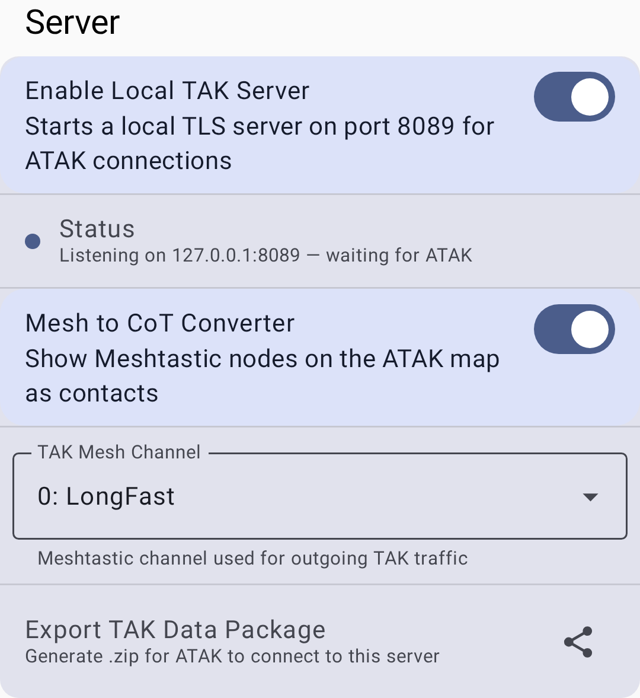

# Integracja TAK

MT_SW integruje się z ekosystemem Team Awareness Kit (TAK), umożliwiając współpracę radiów MT_SW z aplikacjami TAK, takimi jak ATAK i WinTAK.

## Przegląd

Moduł TAK pozwala węzłom MT_SW:
- Udostępniać dane o pozycji w formacie CoT (Cursor on Target) zgodnym z TAK
- Pojawiać się jako członkowie zespołu na mapach TAK
- Odbierać wiadomości TAK PLI (Position Location Information)

## Konfiguracja

### Wymagania wstępne

- Zainstalowany ATAK (Android Team Awareness Kit), iTAK lub WinTAK
- **Rola urządzenia** Twojego węzła (Konfiguracja urządzenia) ustawiona na **TAK** lub **TAK Tracker** — to sprawia, że
  moduł TAK w ogóle pojawia się w Konfiguracji modułów
- Firmware 2.8.0 lub nowsze w radiu. Wcześniejsze firmware przyjmuje zapis konfiguracji TAK i nigdy go
  nie przechowuje, więc aplikacja ukrywa pozycję modułu TAK poniżej tej wersji, nawet gdy rola jest ustawiona
  poprawnie. Zobacz [Aktualizacje firmware](firmware)

> ⚠️ **Ostrzeżenie:** Stara **wtyczka Meshtastic ATAK** nie jest już częścią tej ścieżki i nie może
> działać. Łączyła się przez międzyprocesowe API AIDL, które zostało usunięte w aplikacji 2.8.0; usługa
> mesh działa teraz wyłącznie w obrębie procesu aplikacji. Nie instaluj jej. Współpraca działa dziś przez własny lokalny
> serwer TAK aplikacji oraz Konwerter Mesh na CoT, opisane w następnych sekcjach, ze zwykłymi ATAK/iTAK/WinTAK.

### Konfiguracja

Przejdź do **Ustawienia → Konfiguracja modułów → TAK** (Konfiguracja TAK). Własne ustawienia modułu to Twoja tożsamość TAK —
nie ma tu osobnego przełącznika włączania, ponieważ to ustawienie **Rola urządzenia** w Konfiguracji urządzenia
włącza TAK. Twój węzeł rozgłasza tę tożsamość, która pojawia się na mapach TAK.

| Ustawienie | Opis |
|---------|-------------|
| Kolor zespołu | Twój kolor zespołu na mapie TAK (np. Niebieski, Czerwony, Cyjan, Zielony) |
| Rola członka | Twoja rola operacyjna w tym zespole (Członek zespołu, Lider zespołu, Kwatera główna, Medyk, Operator radiotelefonu itd.) |

Twój znak wywoławczy TAK nie jest osobnym ustawieniem — jest wyprowadzany automatycznie z nazwy Twojego
węzła MT_SW.

> 💡 **Wskazówka:** Kolory zespołów/ról to standardowe kolory przynależności TAK. Uzgodnij ze swoim zespołem TAK
> spójne przydziały do zespołów.

### Lokalny serwer TAK

Aplikacja może też uruchomić **lokalny serwer TAK**, aby ATAK/iTAK na **tym samym telefonie** mogły łączyć się bezpośrednio, bez zdalnego serwera TAK. Serwer nasłuchuje wyłącznie na localhost (`127.0.0.1:8089`) i używa TLS z wzajemnym uwierzytelnianiem certyfikatami (mTLS), więc nie jest osiągalny z innych urządzeń w sieci.

Otwórz **Ustawienia → Zaawansowane → Serwer TAK**. To ustawienia aplikacji przechowywane na tym telefonie, dlatego są obok **Aktualizacja oprogramowania** i **Panel debugowania**, a nie w konfiguracji modułu TAK — i dlatego nie potrzebują ani roli TAK, ani firmware 2.8.0:

- **Włącz lokalny serwer TAK** — uruchamia serwer mTLS tylko na pętli zwrotnej, na porcie **8089**, dla połączeń ATAK/iTAK z tego samego telefonu.
- **Kanał sieci TAK** — wybiera, na którym kanale MT_SW wysyłany jest wychodzący ruch TAK (domyślnie: kanał podstawowy, indeks 0). Przychodzący ruch TAK jest przyjmowany z dowolnego kanału. Odpowiada analogicznemu ustawieniu w iOS i w starszej wtyczce ATAK.
- **Konwerter Mesh na CoT** — domyślnie wyłączony, pokazywany pod przełącznikiem serwera. Przy uruchomionym serwerze
  tworzy kontakt CoT dla każdego węzła w Twojej bazie węzłów, więc zwykłe
  węzły MT_SW pojawiają się na mapie ATAK jako kontakty. **To właśnie zastąpiło widoczność
  węzłów starej wtyczki** — bez tego pokazują się tylko węzły z rolą TAK.
- **Eksportuj pakiet danych TAK** — generuje pakiet danych `.zip`, który ATAK/iTAK mogą zaimportować, aby połączyć się z tym serwerem.

## Role TAK

Węzły skonfigurowane z rolami związanymi z TAK zachowują się inaczej niż standardowi klienci:

| Rola | Opis |
|------|-------------|
| **TAK** | Pełna współpraca z TAK — wysyła i odbiera dane CoT, wiadomości czatu i aktualizacje PLI. Działa jako standardowy klient plus most TAK. |
| **TAK Tracker** | Wyjście TAK tylko z pozycją — automatycznie rozsyła PLI w regularnych odstępach bez udziału użytkownika. Zoptymalizowany do bezobsługowych beaconów pozycji (pojazdy, sprzęt, punkty trasy). Nie przekazuje wiadomości czatu. |

> 💡 **Wskazówka:** Użyj **TAK Tracker** dla urządzeń, które mają tylko raportować pozycję (np. radio zamontowane w pojeździe). Użyj **TAK** dla urządzeń, w których użytkownicy aktywnie uczestniczą w operacjach TAK.

### Format CoT (Cursor on Target)

Wiadomości TAK używają formatu XML Cursor on Target — wojskowego standardu wymiany danych o świadomości sytuacyjnej. MT_SW konwertuje swoje wewnętrzne wiadomości protobuf do formatu CoT podczas łączenia z systemami TAK, więc nie jest potrzebna ręczna konwersja formatu.

## Format transmisji (V1 / V2)

MT_SW obsługuje dwa formaty transmisji TAK, wybierane automatycznie na podstawie firmware podłączonego radia — nie jest potrzebna ręczna konfiguracja:

| Format | Zgodność | Funkcje |
|--------|--------------|----------|
| V1 (starszy) | Firmware 2.7.x i starsze | Surowe kodowanie protobuf na porcie 72. Obsługuje tylko udostępnianie pozycji (PLI) i czat (GeoChat) — kształty, znaczniki, trasy i inne typowane zdarzenia CoT są odrzucane |
| V2 (bieżący) | Firmware 2.8.0+ | Zwarte kodowanie skompresowane zstd na porcie 78. Dodaje kształty, znaczniki, trasy, statki powietrzne, casevac, sytuacje awaryjne i zadania jako typy CoT, oprócz wszystkiego, co obsługuje V1 |

Węzeł nadal przekazuje dalej starsze pakiety V1 z dawniejszych węzłów, nawet gdy sam działa w V2, więc sieci mesh z mieszanym firmware nadal działają.

## Użycie z ATAK

Po skonfigurowaniu:
- Węzły MT_SW pojawiają się jako znaczniki na mapie ATAK z etykietami znaków wywoławczych
- Wiadomości czatu mogą być mostkowane między siecią mesh a sieciami TAK
- Aktualizacje pozycji płyną dwukierunkowo między MT_SW a TAK
- Węzły TAK Tracker automatycznie rozsyłają PLI — ich pozycje pojawiają się na mapach ATAK bez żadnej konfiguracji po stronie ATAK
- Trasy odebrane z sieci mesh są też zapisywane jako pakiet danych (`.zip`) w **Pobrane**; zaimportuj go w ATAK, aby dodać trasę. W Androidzie 9 i starszych plik trafia zamiast tego do własnego folderu aplikacji w `Android/data`

> ℹ️ **Uwaga:** Integracja TAK wymaga określonych ról węzłów. Standardowe węzły klienckie nie uczestniczą automatycznie w operacjach TAK — choć przy włączonym **Konwerter Mesh na CoT** nadal pojawiają się na mapie ATAK jako kontakty.

## Rozwiązywanie problemów

| Problem | Przyczyna | Rozwiązanie |
|---------|-------|----------|
| Węzeł nie pojawia się na mapie ATAK | Złe ustawienie roli urządzenia lub wyłączony Konwerter Mesh na CoT | Ustaw **Rola urządzenia** węzła na TAK lub TAK Tracker. Aby zwykłe węzły (bez roli TAK) się pojawiały, włącz też **Konwerter Mesh na CoT** w **Ustawienia → Zaawansowane → Serwer TAK** |
| Aktualizacje pozycji są nieaktualne | Utracony fix GPS lub zbyt długi interwał | Sprawdź stan GPS; skróć interwał transmisji pozycji w konfiguracji pozycji |
| ATAK pokazuje „disconnected” | Lokalny serwer TAK jest wyłączony lub ATAK wskazuje gdzie indziej | Sprawdź, czy **Włącz lokalny serwer TAK** jest włączone i czy ATAK łączy się z `127.0.0.1:8089` — w razie wątpliwości zaimportuj ponownie wyeksportowany pakiet danych |
| Kształty, znaczniki lub trasy nie są mostkowane | Węzeł wysyłający jest na starszym V1 (firmware 2.7.x lub starsze) | Zaktualizuj firmware węzła wysyłającego do 2.8.0+, aby uzyskać format transmisji V2 |
| Dane CoT nie płyną | Niezgodność kanału | Wszystkie węzły TAK muszą być na tym samym kanale ze zgodnym szyfrowaniem |

## Kwestie bezpieczeństwa

> 🔒 **Prywatność:** Dane TAK udostępniają Twoją pozycję i znak wywoławczy. Moduł TAK respektuje
> to samo szyfrowanie kanału co inne wiadomości MT_SW — w wrażliwych środowiskach używaj
> kanału z kluczem innym niż domyślny.

## Powiązane tematy

- [Ustawienia — Moduły i administracja](settings-module-admin) — konfiguracja modułu TAK
- [Węzły](nodes) — role TAK i TAK Tracker na liście węzłów
- [Mapa i punkty trasy](map-and-waypoints) — pozycje węzłów na mapie
