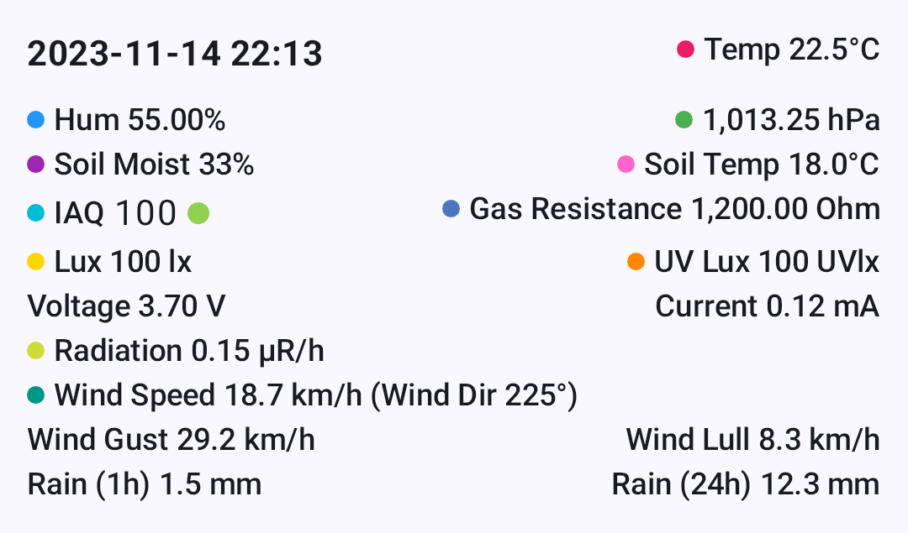

# Jednostki i lokalizacja

Aplikacja automatycznie wyświetla temperatury, odległości, prędkości i czas w jednostkach, które ustawiono na Twoim urządzeniu. Jeśli ustawienia urządzenia nie pozwalają wyrazić potrzebnych Ci jednostek, zastąpi je ustawienie **Jednostki** w aplikacji.

## Jak to działa

Radia zawsze przesyłają dane w **jednostkach metrycznych** (metry, °C, m/s, hPa itd.). Gdy aplikacja odbierze te dane, przelicza je i wyświetla w systemie jednostek wynikającym z ustawień regionalnych urządzenia.

Na Androidzie preferencje pomiarów wynikają z systemowych ustawień **Język i region**. Na komputerze (JVM) aplikacja używa domyślnego `Locale` JVM.

Jednostki zależą od **regionu** urządzenia, a nie od języka wyświetlania. Zwykłe języki — jak **angielski** w ustawieniu Język w samej aplikacji albo w języku aplikacji w Androidzie — zachowują region ustawiony na urządzeniu. Wybór, który zawiera własny region, jak **angielski (Kanada)**, nadpisuje go i wprowadza jednostki tego regionu. W Androidzie 16+ systemowa preferencja **System miar** nadpisuje region dla odległości, prędkości i innych pomiarów — ale nie dla temperatury, która nadal podąża za regionem.

> 💡 **Wskazówka:** Domyślnie nie ma nic do konfigurowania — zmień systemowe preferencje pomiarów, a każdy ekran aplikacji zaktualizuje się automatycznie. Jeśli urządzenie nie oferuje działającego ustawienia regionu ani miar (niektóre wersje producentów go nie mają), ustaw zamiast tego **Ustawienia → Jednostki** w aplikacji.

## Ekran radia jest osobny

**Ustawienia → Konfiguracja urządzenia → Wyświetlacz → Wyświetlana jednostka** konfiguruje ekran na radiu, a nie aplikację. Ustawienia **Użyj formatu 12-godzinnego** i **Zawsze wskazuj północ** także dotyczą tylko wyświetlacza radia — wszystkie trzy. Temperatura na tym ekranie ma własne ustawienie, **Metryki środowiskowe w Fahrenheitach**, w module Telemetria radia — zobacz [opis modułu telemetrii](https://meshtastic.org/docs/configuration/module/telemetry#display-fahrenheit) na meshtastic.org.

Jeśli lista węzłów pokazuje mile, a ekran radia kilometry, to właśnie dlatego: oba ustawia się w różnych miejscach. Zmiana ustawienia radia nigdy nie zmienia tego, co wyświetla aplikacja. Opcje po stronie urządzenia opisuje przewodnik [Konfiguracja wyświetlacza](https://meshtastic.org/docs/configuration/radio/display) na meshtastic.org.

## Temperatura

Wartości temperatury z czujników środowiska są przesyłane w **°C** i wyświetlane według preferencji jednostki temperatury na urządzeniu.

| Twoje ustawienie | Widzisz |
|---|---|
| Celsjusz | 22°C |
| Fahrenheit | 72°F |

Dotyczy to wszystkich miejsc w aplikacji, gdzie jest temperatura: telemetrii środowiska węzła, temperatury gleby, punktu rosy i osi wykresów telemetrii.

Temperatura podąża za **preferencją temperatury** Twojego regionu, niezależnie od systemu odległości. Regiony mieszające systemy działają poprawnie — telefon z Wielkiej Brytanii pokazuje mile dla odległości, ale **°C** dla temperatury. W Androidzie 14+ preferencja **Temperatura** w ustawieniach regionalnych (Ustawienia → System → Języki → Preferencje regionalne) nadpisuje domyślną dla regionu.

## Odległość i wysokość

Odległości między węzłami i wysokości GPS są przesyłane w **metrach** i automatycznie skalowane oraz przeliczane.

| Twoje ustawienie | Mała odległość | Duża odległość | Wysokość |
|---|---|---|---|
| Metryczne | 350 m | 2,5 km | 1 200 m |
| Imperialne (USA) | 1 148 ft | 1,6 mi | 3 937 ft |

Aplikacja skaluje jednostki naturalnie — krótkie odległości zostają w metrach lub stopach, a dłuższe automatycznie przechodzą na kilometry lub mile.

### Gdzie to widać

- **Lista węzłów** — odległość i namiar do każdego węzła
- **Szczegóły węzła** — wysokość, odległość od Twojej pozycji
- **Mapa** — odległości do punktów trasy, odległości skoków traceroute
- **Kompas** — odległość do wybranego węzła

## Prędkość

Prędkość GPS względem ziemi jest wyświetlana w preferowanej dla Twojego regionu jednostce prędkości.

| Twoje ustawienie | Widzisz |
|---|---|
| Metryczne | 12 km/h |
| Imperialne (USA) | 7 mph |

## Wiatr

Prędkość wiatru, porywy i zastoje (lull) są przesyłane przez czujnik w **m/s** i przeliczane do wyświetlenia — aplikacja pokazuje jednostkę, której w Twoim regionie używają prognozy pogody, a nie surową jednostkę czujnika.

| Twoje ustawienie | Widzisz |
|---|---|
| Metryczne | 18,0 km/h |
| Imperialne (USA) | 11,2 mph |

Wszystkie trzy wartości są w tej samej jednostce wszędzie, gdzie się pojawiają: w sekcji środowiska w szczegółach węzła, w dzienniku telemetrii środowiska i na wykresach.

## Waga

Odczyty z podłączonej wagi są przesyłane w **kg** i przeliczane do wyświetlenia.

| Twoje ustawienie | Widzisz |
|---|---|
| Metryczne | 1,50 kg |
| Imperialne (USA) | 3,31 lb |

## Opady deszczu

Pomiary opadów (sumy z 1 godziny i 24 godzin) są przesyłane w **mm** i przeliczane do wyświetlenia.

| Twoje ustawienie | Widzisz |
|---|---|
| Metryczne | 12,0 mm |
| Imperialne (USA) | 0,47 in |

## Jednostki, które nigdy się nie zmieniają

Niektóre jednostki są międzynarodowymi standardami i wyświetlają się tak samo niezależnie od regionu:

| Pomiar | Jednostka | Dlaczego |
|---|---|---|
| Ciśnienie atmosferyczne | hPa | Międzynarodowy standard meteorologiczny |
| Kurs / namiar | ° (stopnie) | Powszechna konwencja nawigacyjna |
| Promieniowanie | µR/h | Standardowa jednostka dozymetryczna |
| Współrzędne GPS | stopnie dziesiętne | Powszechny standard geograficzny |
| Wilgotność, bateria, wilgotność gleby | % | Powszechne |

## Data i czas

Wszystkie znaczniki czasu w aplikacji — ostatnio słyszany, godziny wiadomości, dzienniki telemetrii, osie wykresów — podążają za preferencjami daty i czasu Twojego urządzenia.

| Ustawienie | Co kontroluje | Przykład |
|---|---|---|
| **Czas 24-godzinny** | Format zegara | 14:30 vs 2:30 PM |
| **Format daty** | Kolejność w dacie | 09/05/2026 vs 05/09/2026 |

Aplikacja używa też **czasu względnego** tam, gdzie to ma sens — na przykład „5 min temu" lub „2 godziny temu" na liście węzłów — który jest automatycznie tłumaczony na język urządzenia.

## Zmiana systemu miar

Domyślnie aplikacja podąża za urządzeniem, a Twój system miar (metryczny czy imperialny) jest powiązany z ustawieniem regionu:

1. Otwórz **Ustawienia Androida → System → Język i region**
2. Zmień swój **Region**
3. Wróć do aplikacji — wartości aktualizują się natychmiast

W Androidzie 16+ systemowa preferencja **System miar** nadpisuje region dla odległości, prędkości i innych pomiarów — ale nie dla temperatury. Temperatura jest ustalana osobno, a w Androidzie 14+ nadpisujesz ją osobno w **Preferencje regionalne → Temperatura**.

Nie każdy region anglojęzyczny jest w pełni metryczny. **Angielski (Wielka Brytania)** używa mil i stóp dla odległości, więc lista węzłów pokazuje mile, a wysokość w stopach. Aby mieć odległości metryczne, ustaw w aplikacji **Jednostki** na Metryczne (zobacz [Nadpisywanie jednostek w aplikacji](#overriding-the-units-in-the-app)) albo wybierz region w pełni metryczny, taki jak angielski (Kanada), angielski (Irlandia) lub angielski (Nowa Zelandia).

Niektóre telefony w ogóle nie oferują menu **Preferencje regionalne** i wymieniają tylko angielski (Stany Zjednoczone). Na takich urządzeniach użyj ustawienia **Jednostki** w aplikacji (zobacz [Nadpisywanie jednostek w aplikacji](#overriding-the-units-in-the-app)).

### Nadpisywanie jednostek w aplikacji

Nie każde urządzenie potrafi wyrazić każdą preferencję — niektóre wersje producentów nie mają w ogóle preferencji regionalnych,
inne oferują tylko jeden wariant angielskiego, a regiony brytyjskie są imperialne dla odległości, nawet jeśli wolisz czytać wysokość
w metrach. Na takie przypadki aplikacja ma własny przełącznik:

1. Otwórz **Ustawienia → Jednostki** w aplikacji
2. Wybierz **Domyślny systemu**, **Metryczne** lub **Imperialne**
3. Każdy ekran aktualizuje się natychmiast — bez restartu

**Domyślny systemu** podąża za regionem i ustawieniami miar Twojego telefonu lub komputera. Wymuszenie **Metryczne** lub **Imperialne** dotyczy
wszystkiego, także temperatury (metryczne → °C, imperialne → °F), nawet jeśli własne preferencje regionalne systemu mówią
co innego. To ustawienie istnieje zarówno na Androidzie, jak i na komputerze.

## Powiązane tematy

- [Metryki węzła](node-metrics) — gdzie wyświetlane są temperatura, odległość i wartości z czujników
- [Telemetria i czujniki](telemetry-and-sensors) — czujniki, które wytwarzają te pomiary
- [Pomiary i formatowanie](../developer/measurement) — opis dla programistów narzędzi formatowania
- [Ustawienia — Radio i użytkownik](settings-radio-user) — ustawienie regionu, od którego zależy wybór jednostek
- [Konfiguracja wyświetlacza](https://meshtastic.org/docs/configuration/radio/display) — jednostki, zegar i kompas na własnym ekranie radia, na meshtastic.org
