# `:feature:widget`

## Overview

The `:feature:widget` module holds the **Android-only Jetpack Glance home-screen widgets** (API 26+):

- `MeshStatusWidget` (MT_SW statistics) shows the same statistics as the permanent notification.
- `SosWidget` sends the alarm after several quick taps.

**Target: Android only** (not KMP — uses `meshtastic.android.library` + `meshtastic.android.library.compose` convention plugins)

## Key Responsibilities

- Display live mesh statistics and the SOS button on the Android home screen via Jetpack Glance
- Fulfill the `AppWidgetUpdater` interface from `:core:repository` so the mesh service can trigger widget refreshes without depending on Android widget APIs

## Source Structure

```text
src/main/kotlin/org/meshtastic/feature/widget/
├── WidgetSizes.kt                   ← size thresholds, line budget and type scale shared by both widgets
├── WidgetComponents.kt              ← brand header, identity row, stat and bar rows, status body
├── AndroidAppWidgetUpdater.kt       ← implements AppWidgetUpdater (core:repository)
├── WidgetResourceEnvironment.kt     ← bridges Compose resources into Glance
└── di/
    └── FeatureWidgetModule.kt
```

Glance doesn't provide the Compose UI locals that Compose Multiplatform's `stringResource` reads, so `WidgetResourceEnvironment` bridges them into the widget's composition; every translated string in the widget depends on it. A composition failure shows the `widget_composition_error` layout through `onCompositionError` instead of crashing the app.

## `AppWidgetUpdater` integration

The mesh service holds a reference to `AppWidgetUpdater` (defined in `:core:repository`) without depending on Android widget APIs. `AndroidAppWidgetUpdater` in this module provides the concrete implementation:

```kotlin
// Simplified — the real update wraps each call in a try/catch
@Single
class AndroidAppWidgetUpdater(
    private val context: Context,
    meshStatusProvider: MeshStatusWidgetStateProvider,
) : AppWidgetUpdater {
    override suspend fun updateAll() {
        MeshStatusWidget().updateAll(context)
    }
}
```

It also drives re-renders itself, because Glance compositions are ephemeral:

- MT_SW statistics: redrawn when `meshStatusProvider.state` changes and every minute, because it rotates between nodes.

This keeps the service layer platform-agnostic while still enabling widget refresh on data changes.

## Dependency Graph

### Key Dependencies

```text
feature:widget (Android only)
  ├── core:common, core:model, core:navigation, core:resources, core:repository, core:ui
  ├── androidx.glance.appwidget, glance.material3, glance.preview, glance.appwidget.preview
  ├── androidx.activity.compose, compose.multiplatform.material3
  ├── compose.multiplatform.ui (LocalConfiguration, LocalDensity), compose.multiplatform.resources
  └── kermit
```

## Testing

This is a plain Android library, so its unit tests run under `./gradlew :feature:widget:testDebugUnitTest` (or the root `test` task), with Robolectric and Glance's testing artifacts.

```mermaid
graph TB
  :feature:widget[widget]:::android-feature
  :feature:widget -.-> :core:common
  :feature:widget -.-> :core:model
  :feature:widget -.-> :core:navigation
  :feature:widget -.-> :core:resources
  :feature:widget -.-> :core:repository
  :feature:widget -.-> :core:ui
  :feature:widget -.-> :core:testing

classDef android-application fill:#CAFFBF,stroke:#000,stroke-width:2px,color:#000;
classDef android-application-compose fill:#CAFFBF,stroke:#000,stroke-width:2px,color:#000;
classDef compose-desktop-application fill:#CAFFBF,stroke:#000,stroke-width:2px,color:#000;
classDef android-feature fill:#FFD6A5,stroke:#000,stroke-width:2px,color:#000;
classDef android-library fill:#9BF6FF,stroke:#000,stroke-width:2px,color:#000;
classDef android-library-compose fill:#9BF6FF,stroke:#000,stroke-width:2px,color:#000;
classDef android-test fill:#A0C4FF,stroke:#000,stroke-width:2px,color:#000;
classDef jvm-library fill:#BDB2FF,stroke:#000,stroke-width:2px,color:#000;
classDef kmp-feature fill:#FFD6A5,stroke:#000,stroke-width:2px,color:#000;
classDef kmp-library-compose fill:#FFC1CC,stroke:#000,stroke-width:2px,color:#000;
classDef kmp-library fill:#FFC1CC,stroke:#000,stroke-width:2px,color:#000;
classDef unknown fill:#FFADAD,stroke:#000,stroke-width:2px,color:#000;

```

<!--region graph-->

<!--endregion-->
